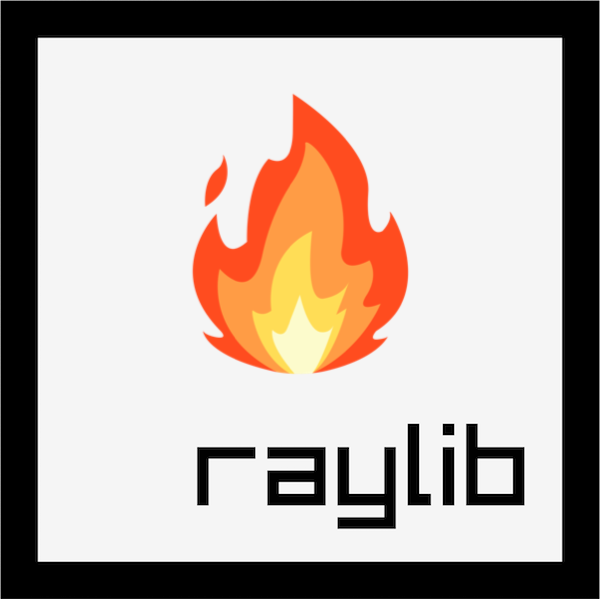

# mojo-raylib

<a name="readme-top"></a>
<br />

<div align="center">
    

  <h3 align="center">Mojo Raylib</h3>

  <p align="center">
    🔥 Mojo bindings for <a href="https://github.com/raysan5/raylib">raylib</a> v6.x 🔥
    <br/>

![Written in Mojo][language-shield]
[![MIT License][license-shield]][license-url]
[](https://github.com/kivicode/mojo-raylib/actions/workflows/github-code-scanning/codeql)

<br/>

[![Contributors Welcome][contributors-shield]][contributors-url]

  </p>
</div>

Code generation is fully automated and provides 100% coverage, although not everything has been manually tested yet.

## Requirements

- [Pixi](https://prefix.dev/) — installs the monorepo's pinned Mojo compiler, raylib, and the build toolchain.
- Initialize the pinned native source from the Mojoverse root with `git submodule update --init`.

## Editor and LSP setup

This repository includes workspace settings for the official
[Mojo VS Code extension](https://github.com/modular/vscode-mojo), including
format-on-save and automatic selection of the workspace-local Pixi environment.
The same setup works in VS Code-compatible editors such as Cursor.

```sh
pixi install
code .
```

Install the recommended Mojo and Python extensions when prompted, then open a
`.mojo` file. The Mojo status item should show the SDK from
`.pixi/envs/default`. Hover over a type or function for its summary and use
signature help to see its documented arguments and return value. Public
functions also expose snake-case parameter names in completion:

```mojo
from mojo_raylib import init_window, window_should_close

init_window(800, 450, "LSP-ready raylib")
if window_should_close():
    pass
```

In a project that consumes `mojo_raylib`, run `pixi install` and open that
project's root (the directory containing its `pixi.toml`). The LSP resolves the
installed `mojo_raylib.mojoc` package from that project's Pixi environment, so
no manual include path is required.

If the extension does not find Mojo, run **Python: Select Interpreter** and
choose `.pixi/envs/default/bin/python`. As a final fallback, set
`mojo.sdk.path` to the absolute path of `.pixi/envs/default`; the extension
requires an absolute SDK path for this override.

The ergonomic API is documented at the package root. The `mojo_raylib.raw`
subpackage is also documented, but intentionally exposes C-layout types,
untracked pointers, and manual resource-lifetime requirements.

```sh
pixi run doc-check  # enforce complete, well-formed public docstrings
pixi run docs       # write build/docs/mojo_raylib.json
```

## Run an example

```sh
cd examples/basic_window
pixi run run
```

The first run builds raylib + the C shim (`mojo-raylib-shim`) and precompiles the Mojo package (`mojo_raylib`). Subsequent runs hit the build cache.

`mojo_raylib` uses Pixi's [`pixi-build-mojo`](https://pixi.prefix.dev/latest/build/backends/pixi-build-mojo/) backend, while the native shim uses `pixi-build-rattler-build`. Development, build, host and runtime use the same compiler as the rest of Mojoverse. Native builds use Clang `-O3 -march=native` and Pixi's build cache.

## Use it in your own project

Each example is a self-contained `pixi.toml`:

```toml
[workspace]
channels = ["https://conda.modular.com/max", "https://prefix.dev/conda-forge"]
platforms = ["osx-arm64", "linux-64"]
preview = ["pixi-build"]

[dependencies]
mojo_raylib = { path = "../mojoverse/packages/mojo-raylib" }

[tasks.run]
cmd = "mojo build main.mojo -Xlinker -L$CONDA_PREFIX/lib -Xlinker -lmojo_raylib_shim -Xlinker -lraylib -o .pixi/main && .pixi/main"
```

The source dependency reads this repository's package metadata, invokes `pixi-build-mojo`, and installs the compiled `mojo_raylib.mojoc` package plus its native runtime dependencies into the consuming environment. Keep `preview = ["pixi-build"]` enabled in the consuming workspace; no copied build scripts or manual `MODULAR_HOME` setup are needed.

```mojo
from mojo_raylib import Color, init_window, close_window, window_should_close
from mojo_raylib import begin_drawing, end_drawing, clear_background, draw_text, set_target_fps

def main():
    init_window(800, 450, "hello")
    set_target_fps(60)
    while not window_should_close():
        begin_drawing()
        clear_background(Color(245, 245, 245, 255))
        draw_text("Hello, raylib!", 190, 200, 20, Color(50, 50, 50, 255))
        end_drawing()
    close_window()
```

## Regenerating bindings

The Mojo bindings + C shim are emitted by a patched `rlparser` (`patch/rlparser.c`) reading raylib's headers.

```sh
pixi run -e codegen generate      # regenerate mojo_raylib/ + native/mojo_raylib_shim.c
pixi run -e codegen regen-check   # CI: fail if regeneration would change anything
pixi run doc-check                # fail on missing or malformed API documentation
```

The generator turns raylib's API comments into Mojo docstrings and adds
structured `Args`, `Returns`, and ownership information so hover and signature
help stay complete after every regeneration. Hand-written APIs follow Mojo's
[docstring style guide](https://github.com/modular/modular/blob/main/mojo/stdlib/docs/docstring-style-guide.md).

## Layout

```
pixi.toml                workspace + mojo_raylib package (pixi-build-mojo backend)
shim/                    mojo-raylib-shim package (pixi-build-rattler-build, builds raylib + the C shim)
mojo_raylib/             generated safe API + raw FFI bindings
native/mojo_raylib_shim.c   generated C shim
patch/rlparser.c         patched raylib code-gen tool
vendor/raylib/           git submodule, pinned by parent commit
examples/<name>/         per-example pixi.toml + main.mojo
```

<!-- MARKDOWN LINKS & IMAGES -->
<!-- https://www.markdownguide.org/basic-syntax/#reference-style-links -->

[language-shield]: https://img.shields.io/badge/language-mojo-orange
[license-shield]: https://img.shields.io/github/license/kivicode/mojo-raylib?logo=github
[license-url]: https://github.com/kivicode/mojo-raylib/blob/main/LICENSE
[contributors-shield]: https://img.shields.io/badge/contributors-welcome!-blue
[contributors-url]: https://github.com/kivicode/mojo-raylib#contributing
